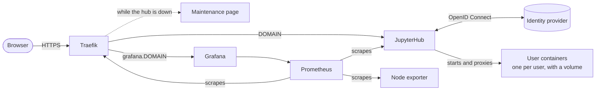

# Dockerized JupyterHub

[](https://github.com/irfan-farmer/dockerized-jupyterhub/actions/workflows/ci.yml)

A production-ready JupyterHub for a single Docker host, sized for teams, courses and research groups with tens to a few hundred users. Each user gets their own container and persistent storage, and logs in through your organization's identity provider. The whole stack is one `compose.yaml` plus one `.env` file.

## What's included

- **JupyterHub 6 with DockerSpawner**: one container and one persistent volume per user, with CPU, memory and process limits.
- **Login through any OpenID Connect provider**, such as Keycloak, Microsoft Entra ID, Google or Authentik. Only the users or groups you list can log in.
- **Traefik 3** with automatic Let's Encrypt certificates. All traffic is HTTPS.
- **Prometheus and Grafana** with a ready-made dashboard for active users, server starts, traffic and host resources.
- **A maintenance page** while the hub is starting or stopped.
- **Pinned versions**, a smoke test in CI, and weekly dependency updates through Dependabot.

## Is this the right fit?

| | Users | Runs on | Users isolated by |
|---|---|---|---|
| [The Littlest JupyterHub](https://tljh.jupyter.org) | up to about 100 | one server | Unix accounts |
| **This project** | tens to a few hundred | one Docker host | containers |
| [Zero to JupyterHub](https://z2jh.jupyter.org) | hundreds to thousands | Kubernetes | containers |

Choose this project if you want container isolation and monitoring without running Kubernetes. Everything runs on one host, so that host's memory and CPU limit how many people can work at once, and there is no failover.

To size the host, plan for `USER_MEM_LIMIT` × peak concurrent users, plus 2 GB for the stack. With the default 2 GB limit, a 64 GB host serves about 30 people at once.

## Architecture



Only Traefik publishes ports. Separate Docker networks keep user containers away from the proxy's internals and the monitoring stack.

## Requirements

- A Linux server with Docker Engine 25 or newer and the Docker Compose plugin 2.24 or newer.
- DNS records for `DOMAIN` and `grafana.DOMAIN` that point to the server. Ports 80 and 443 must be reachable from the internet, because Let's Encrypt validates over port 80.
- An OpenID Connect client registered with your identity provider, with the redirect URI `https://DOMAIN/hub/oauth_callback`.

## Quick start

```bash
git clone https://github.com/irfan-farmer/dockerized-jupyterhub.git
cd dockerized-jupyterhub
cp .env.example .env
chmod 600 .env
```

Fill in the required values in `.env`. Each one is explained in the file. Then start the stack:

```bash
docker compose up -d --build
```

Open `https://DOMAIN` and sign in with an account listed in `ADMIN_USERS`. Grafana is at `https://grafana.DOMAIN`: sign in as `admin` with `GRAFANA_ADMIN_PASSWORD`.

The first time someone starts a server, the notebook image (a few GB) is downloaded, which can take several minutes. To skip that wait, pull the image in advance:

```bash
docker pull quay.io/jupyter/scipy-notebook:2026-10-19
```

## Configuration

Routine settings live in `.env`, and [.env.example](.env.example) documents every variable. [docs/configuration.md](docs/configuration.md) covers identity providers, access control, notebook images, resource limits and shared data.

For changes beyond `.env`, use `jupyterhub/jupyterhub_config.local.py` and `compose.override.yaml`. Git ignores both files, so `git pull` never conflicts with your changes.

## Documentation

- [Configuration](docs/configuration.md)
- [Operations](docs/operations.md): updates, backups, user data, maintenance and troubleshooting
- [Security and privacy](docs/security-and-privacy.md): how the stack is secured and what personal data it processes

## Repository layout

```text
compose.yaml    all services
.env.example    settings template
jupyterhub/     hub image and jupyterhub_config.py
traefik/        security headers
maintenance/    page shown while the hub is down
prometheus/     scrape configuration
grafana/        settings, data source and dashboard
tests/          smoke test, also run by CI
docs/           configuration, operations, security and privacy
```

## Contributing and license

See [CONTRIBUTING.md](CONTRIBUTING.md) for how to propose changes. Releases follow [Semantic Versioning](https://semver.org/) and are listed in [CHANGELOG.md](CHANGELOG.md). Report security issues as described in [SECURITY.md](SECURITY.md).

Released under the [MIT License](LICENSE). Originally built for the MOSAiC Virtual Research Environment (M-VRE).
