# JupyterHub Deployment with Docker, Traefik, Prometheus, and Grafana

## Overview

This project provides a Docker-based deployment of JupyterHub with a comprehensive ecosystem of supporting technologies. Developed as part of the M-VRE (MOSAiC Virtual Research Environment) project, it offers a scalable, customizable, and production-ready solution for deploying multi-user Jupyter notebook environments.

## 🏗 Architecture




The diagram above illustrates the system architecture:

1. Traefik handles load balancing to the JupyterHub multi-user server
2. JupyterHub handles authentication and spawns individual notebook servers
3. Prometheus collects metrics from all components
4. Grafana provides visualization of the collected metrics

## 🌟 Features

- **Multi-User JupyterHub**: Robust multi-user Jupyter notebook server
- **Traefik Reverse Proxy**: Automatic SSL (Let's Encrypt) and load balancing
- **Prometheus Monitoring**: Comprehensive metrics collection
- **Grafana Visualization**: Customizable dashboards for real-time insights
- **Docker Compose**: Simplified service management
- **Highly Customizable**: Support for custom Docker images and volume mounts
- **Scalable Architecture**: Designed for medium-scale deployments

## 📋 Prerequisites

Before getting started, ensure you have:

- [Docker](https://docs.docker.com/get-docker/)
- [Docker Compose](https://docs.docker.com/compose/install/)
- [Git](https://git-scm.com/downloads)

## 🚀 Quick Start

### 1. Clone the Repository

```bash
git clone https://github.com/your-username/your-repo-name.git
cd your-repo-name
```

### 2. Configure Environment Variables

```bash
cp .env.example .env
```

Edit the `.env` file with your specific configurations:

### 3. Launch Services

```bash
# Build and start services
docker-compose up -d

# Verify running containers
docker-compose ps
```
### 3. Stopping all the Services

```bash
docker-compose down
Note: After modifying Dockerfiles, run docker-compose build before restarting.
```

## 🔧 Customization

### Custom Docker Images

Modify `jupyterhub_config.py` to add custom images:

```python
c.DockerSpawner.allowed_images = {

    'server_name': 'your-custom-image_name:version'
}
```

### Volume Mounts

For persistent storage, configure docker volumes in `jupyterhub_config.py`:

```python
c.DockerSpawner.volumes = {
    '/mnt/workspace/{username}': '/home/jovyan/work',
    '/mnt/custom-data': {'bind': '/home/jovyan/custom-data', 'mode': 'rw'}
}
```

### Custom Authentication Methods

We're using Helmholtz AAI based authentication for:
    
    1. Federated identity management
    2. Single sign-on across research networks
    3. Centralized access control

For other authentication options, please take a look at: [https://jupyterhub.readthedocs.io/en/latest/reference/authenticators.html]

Configuration Example (OAuth). Please, change the authenticator section in `jupyterhub_config.py` based on the authenticator you decide to use:

```python
c.JupyterHub.authenticator_class = 'oauthenticator.generic.GenericOAuthenticator'
```

## 🌐 Accessing Services

- **JupyterHub**: `https://your-domain.com`
- **Traefik Dashboard**: `http://your-domain.com:8080`
- **Prometheus**: `http://your-domain.com:9090`
- **Grafana**: `http://your-domain.com:3000` 

## 📊 Monitoring and Visualization

### Prometheus Metrics

Tracks:
- JupyterHub: User activity, server spawn times
- Traefik: HTTP request metrics
- Docker: Container resource usage
- System metrics via Node Exporter (This is optional. It can be enabled via prometheus.yml. Just uncomment the section and add corresponding service inside docker_compose.yml)

### Grafana Dashboards

Pre-configured dashboards for:
- JupyterHub metrics
- Traefik performance
- Docker and system resources

## 🆚 Comparison with Alternatives

### Zero to JupyterHub
- Kubernetes-focused
- Complex setup
- Best for large-scale cloud deployments

### The Littlest JupyterHub
- Lightweight
- Easy setup
- Limited scalability

### Our Solution
- Balance of simplicity and scalability
- Highly customizable
- Integrated monitoring
- Flexible deployment options

## 🛠 Troubleshooting

### Common Issues

- **Authentication Failures**: Verify OAuth/AAI configuration, Check client credentials
- **Prometheus Targets Down**: Check service logs, Review Traefik routing configurations and Adjust container resource limits
- **Traefik Metrics Unavailable**: Verify metrics exposure
- **JupyterHub Metrics Missing**: Confirm `/hub/metrics` configuration

Some useful diagnostic commands:

```bash
# Check service health
docker-compose ps

# View detailed logs
docker-compose logs <service-name>

# Network diagnostics
docker network inspect <network_service_name>
```

## 🤝 Contributing

1. Fork the repository
2. Create a feature branch
3. Commit changes
4. Push to the branch
5. Open a pull request

## 📄 License

This project is licensed under the MIT License - see the [LICENSE](./LICENSE) file for details.

The MIT License is a permissive license that allows you to:
- Use the code commercially
- Modify the code
- Distribute the code
- Use the code privately

For the full license terms and conditions, please refer to the [LICENSE](./LICENSE) file in the repository.


## 🙏 Acknowledgments

- JupyterHub [https://jupyter.org/hub]
- Traefik [https://traefik.io/]
- Prometheus [https://prometheus.io/]
- Grafana [https://grafana.com/]
- M-VRE Team [https://mosaic-vre.org/team]

## About M-VRE Project

Developed for the MOSAiC-Virtual Research Environment (M-VRE), this solution provides researchers seamless access to MOSAiC data through Jupyter notebooks, including specialized data analysis services like DIVA [https://github.com/gher-uliege/DIVAnd.jl]

