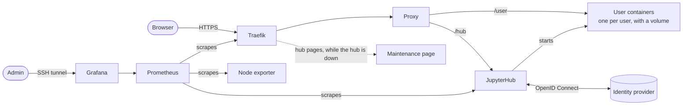

# Dockerized JupyterHub

[](https://github.com/irfan-farmer/dockerized-jupyterhub/actions/workflows/ci.yml)

A production-ready JupyterHub for a single Docker host, sized for teams, courses and research groups with tens to a few hundred users. Each user gets their own container and persistent storage, and logs in through your organization's identity provider. The whole stack is one `compose.yaml` plus one `.env` file.

## What's included

- **JupyterHub 6 with DockerSpawner**: one container and one persistent volume per user, with CPU, memory and process limits.
- **Login through any OpenID Connect provider**, such as Keycloak, Microsoft Entra ID, Google or Authentik. Only the users or groups you list can log in.
- **Traefik 3** with automatic Let's Encrypt certificates. All traffic is HTTPS.
- **No interruptions during hub restarts**: open notebooks keep working, and hub pages show a maintenance page until the hub is back.
- **Prometheus and Grafana** with a ready-made dashboard for active users, server starts, traffic and host resources. Grafana is only reachable through an SSH tunnel.
- **A ready-made hub image** with signed build provenance, so deploying needs no build step.
- **Pinned versions**, Python packages locked by hash, a smoke test and vulnerability scan in CI, and weekly dependency updates through Dependabot.

## Is this the right fit?

| | Users | Runs on | Users isolated by |
|---|---|---|---|
| [The Littlest JupyterHub](https://tljh.jupyter.org) | up to about 100 | one server | Unix accounts |
| **This project** | tens to a few hundred | one Docker host | containers |
| [Zero to JupyterHub](https://z2jh.jupyter.org) | hundreds to thousands | Kubernetes | containers |

Choose this project if you want container isolation and monitoring without running Kubernetes. Everything runs on one host, so that host's memory and CPU limit how many people can work at once, and there is no failover.

To size the host, plan for `USER_MEM_LIMIT` × peak concurrent users, plus 2 GB for the stack. With the default 2 GB limit, a 64 GB host serves about 30 people at once.

## Architecture



Traefik is the only service reachable from the internet. It sends every request to the proxy, which forwards hub pages to JupyterHub and everything else to the user's own container. The proxy runs on its own, so open notebooks keep working while the hub restarts.

Traefik has no access to Docker; only the hub does, to start user containers. Grafana listens on the server's localhost only. Separate Docker networks keep user containers away from Traefik and the monitoring stack.

## Requirements

- A Linux server with Docker Engine 25 or newer and the Docker Compose plugin 2.24 or newer.
- A DNS record for `DOMAIN` that points to the server. Ports 80 and 443 must be reachable from the internet, because Let's Encrypt validates over port 80.
- An OpenID Connect client registered with your identity provider, with the redirect URI `https://DOMAIN/hub/oauth_callback`.
- Disk space for users' files where Docker keeps its data (usually `/var/lib/docker`). Ideally that's a separate disk from the operating system, because a full disk stops the hub for everyone.

## Quick start

Get the latest release:

```bash
git clone https://github.com/irfan-farmer/dockerized-jupyterhub.git
cd dockerized-jupyterhub
git checkout "$(git describe --tags --abbrev=0)"
```

Create `.env` and fill in the required values. Each one is explained in the file:

```bash
cp .env.example .env
chmod 600 .env
```

Generate the four random values:

```bash
for name in METRICS_TOKEN PROXY_AUTH_TOKEN GRAFANA_SECRET_KEY GRAFANA_ADMIN_PASSWORD; do
  sed -i "s/^$name=\$/$name=$(openssl rand -hex 32)/" .env
done
```

Start the stack:

```bash
docker compose up -d
```

Open `https://DOMAIN` and sign in with an account listed in `ADMIN_USERS`. When the hub starts, it downloads the notebook image (a few GB) in the background. Until that finishes, the first server start takes longer.

To open Grafana, create an SSH tunnel from your computer, then go to `http://localhost:3000` and sign in as `admin` with `GRAFANA_ADMIN_PASSWORD`:

```bash
ssh -L 3000:localhost:3000 you@your-server
```

## Configuration

Routine settings live in `.env`, and [.env.example](.env.example) documents every variable. [docs/configuration.md](docs/configuration.md) covers identity providers, access control, notebook images, resource limits and shared data.

For changes beyond `.env`, use `jupyterhub/jupyterhub_config.local.py` and `compose.override.yaml`. Git ignores both files, so `git pull` never conflicts with your changes.

## Documentation

- [Configuration](docs/configuration.md)
- [Operations](docs/operations.md): updates, backups, user data, maintenance and troubleshooting
- [Security and privacy](docs/security-and-privacy.md): how the stack is secured and what personal data it processes

## Repository layout

```text
compose.yaml    all services
.env.example    settings template
jupyterhub/     hub image and jupyterhub_config.py
traefik/        routes and security headers
maintenance/    page shown while the hub is down
prometheus/     scrape configuration
grafana/        settings, data source and dashboard
tests/          smoke test, also run by CI
docs/           configuration, operations, security and privacy
.github/        CI, release and Dependabot configuration
```

## Contributing and license

See [CONTRIBUTING.md](CONTRIBUTING.md) for how to propose changes. Releases follow [Semantic Versioning](https://semver.org/) and are listed in [CHANGELOG.md](CHANGELOG.md). Report security issues as described in [SECURITY.md](SECURITY.md).

Released under the [MIT License](LICENSE). Originally built for the MOSAiC Virtual Research Environment (M-VRE).
