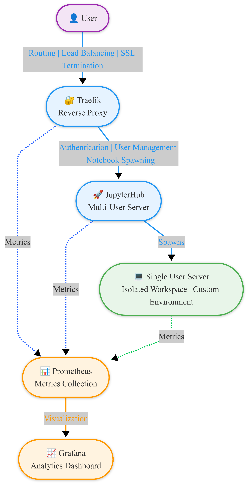

# JupyterHub Deployment with Docker, Traefik, Prometheus, and Grafana

## Overview

This project provides a Docker-based deployment of JupyterHub with a comprehensive ecosystem of supporting technologies. Developed as part of the M-VRE (MOSAiC Virtual Research Environment) project, it offers a scalable, customizable, and production-ready solution for deploying multi-user Jupyter notebook environments.

## 🏗 Architecture



The diagram above illustrates the system architecture:
1. Users authenticate through Traefik reverse proxy
2. Traefik handles load balancing to the JupyterHub multi-user server
3. JupyterHub spawns individual Jupyter server workspaces
4. Prometheus collects metrics from all components
5. Grafana provides visualization of the collected metrics

## 🌟 Features

- **Multi-User JupyterHub**: Robust multi-user Jupyter notebook server
- **Traefik Reverse Proxy**: Automatic SSL (Let's Encrypt) and load balancing
- **Prometheus Monitoring**: Comprehensive metrics collection
- **Grafana Visualization**: Customizable dashboards for real-time insights
- **Docker Compose**: Simplified service management
- **Highly Customizable**: Support for custom Docker images and volume mounts
- **Scalable Architecture**: Designed for medium to large-scale deployments

## 📋 Prerequisites

Before getting started, ensure you have:

- [Docker](https://docs.docker.com/get-docker/)
- [Docker Compose](https://docs.docker.com/compose/install/)
- [Git](https://git-scm.com/downloads)

## 🚀 Quick Start

### 1. Clone the Repository

```bash
git clone https://github.com/your-username/your-repo-name.git
cd your-repo-name
```

### 2. Configure Environment Variables

```bash
cp .env.example .env
```

Edit the `.env` file with your specific configurations:
- `HOST`: Your domain
- `CLIENT_ID`: OAuth client ID
- `CLIENT_SECRET`: OAuth client secret
- `API_TOKEN`: API access token

### 3. Launch Services

```bash
docker-compose up -d
```

## 🔧 Customization

### Custom Docker Images

Modify `jupyterhub_config.py` to add custom images:

```python
c.DockerSpawner.allowed_images = {
    'DIVA': 'abarth/divand-jupyterhub:latest',
    'minimal-notebook': 'jupyter/minimal-notebook:x86_64-ubuntu-22.04',
    'custom-image': 'your-custom-image:latest'
}
```

### Volume Mounts

Configure custom volume mounts in `jupyterhub_config.py`:

```python
c.DockerSpawner.volumes = {
    '/mnt/p_mvre_workspace/{username}': '/home/jovyan/work',
    '/mnt/mosaic_data': {'bind': '/home/jovyan/mosaic_data', 'mode': 'ro'},
    '/mnt/custom-data': {'bind': '/home/jovyan/custom-data', 'mode': 'rw'}
}
```

## 🌐 Accessing Services

- **JupyterHub**: `https://your-domain.com`
- **Traefik Dashboard**: `http://your-domain.com:8080`
- **Prometheus**: `http://your-domain.com:9090`
- **Grafana**: `http://your-domain.com:3000` (default: admin/admin)

## 📊 Monitoring and Visualization

### Prometheus Metrics

Tracks:
- JupyterHub: User activity, server spawn times
- Traefik: HTTP request metrics
- Docker: Container resource usage
- System metrics via Node Exporter

### Grafana Dashboards

Pre-configured dashboards for:
- JupyterHub metrics
- Traefik performance
- Docker and system resources

## 🆚 Comparison with Alternatives

### Zero to JupyterHub
- Kubernetes-focused
- Complex setup
- Best for large-scale cloud deployments

### The Littlest JupyterHub
- Lightweight
- Easy setup
- Limited scalability

### Our Solution
- Balance of simplicity and scalability
- Highly customizable
- Integrated monitoring
- Flexible deployment options

## 🛠 Troubleshooting

### Common Issues

- **Prometheus Targets Down**: Check service logs
- **Traefik Metrics Unavailable**: Verify metrics exposure
- **JupyterHub Metrics Missing**: Confirm `/hub/metrics` configuration

View service logs:
```bash
docker-compose logs <service-name>
```

## 🤝 Contributing

1. Fork the repository
2. Create a feature branch
3. Commit changes
4. Push to the branch
5. Open a pull request

## 📄 License

MIT License - See `LICENSE` file for details.

## 🙏 Acknowledgments

- JupyterHub
- Traefik
- Prometheus
- Grafana
- M-VRE Project

## About M-VRE Project

Developed for the MOSAiC-Virtual Research Environment (M-VRE), this solution provides researchers seamless access to MOSAiC data through Jupyter notebooks, including specialized data analysis services like DIVAnd.


